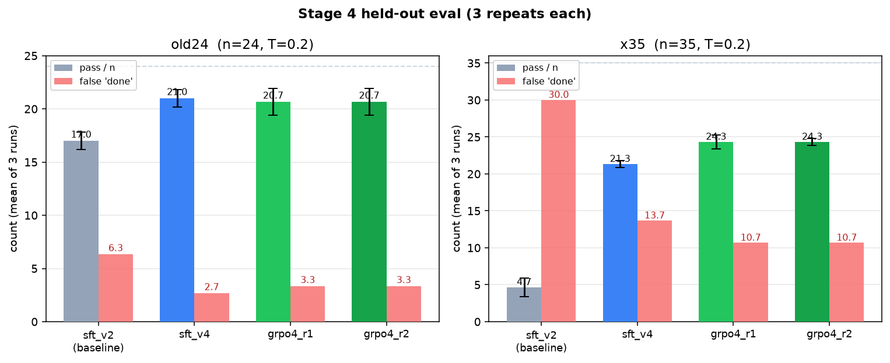
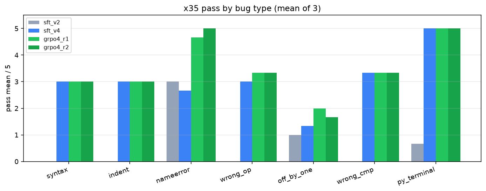

# Teaching a model to use a computer

This repo shows how I took a base vision-language model that could not use a computer, and trained it until it could.

The model is [Qwen2.5-VL-7B](https://huggingface.co/Qwen/Qwen2.5-VL-7B-Instruct). It sees screenshots and outputs actions (click, type, and so on). The goal was to have it do what a person would do:

1. Open a coding environment (Jupyter)
2. Write code
3. Run it
4. Read the error
5. Fix the bug
6. Run it again

The test sets below were locked before training. None of them were used as training data.

I wrote a longer walkthrough of how I did this in [article.md](article.md).

## Results

Two locked test sets, each run 3 times at temperature 0.2.

**Original 24 tasks** (write new functions, debug a file, handle a changed screen layout, or use the terminal only):

| Model | Average score | False "done" claims |
| --- | --- | --- |
| After early fine-tuning (SFT v2) | 17.0 / 24 (71%) | 6.3 |
| After more targeted demos (SFT v4) | **21.0 / 24 (88%)** | 2.7 |
| After one round of RL (GRPO) | 20.7 / 24 (86%) | 3.3 |

**New 35 debugging tasks** (5 each of 7 bug types: syntax, indentation, name errors, wrong operator, off-by-one, wrong comparison, and a `.py` file fixed from the terminal):

| Model | Average score | False "done" claims |
| --- | --- | --- |
| After early fine-tuning (SFT v2) | 4.7 / 35 (13%) | 30.0 |
| After more targeted demos (SFT v4) | 21.3 / 35 (61%) | 13.7 |
| After one round of RL (GRPO) | **24.3 / 35 (70%)** | 10.7 |

The untrained base model scored **0 / 24** on the original test set in an earlier eval (a single run, not part of the 3-run protocol above).

What this means:

- Fine-tuning on successful demos taught the model the basic computer-use loop.
- Extra, carefully targeted debugging demos caused the big jump (13% → 61% on the debugging set).
- One round of reinforcement learning (GRPO) then fixed cases the demos missed, taking debugging from 61% to 70%. A second GRPO round did not improve further, so training stopped there.

A false "done" claim means the model said it was finished, but an automatic checker found the task was still wrong.





## How training worked

1. **Supervised fine-tuning (imitation).** I recorded successful demos of the full loop: open Jupyter, edit only the buggy line, run the code, read the output, then say "done". The model learned to copy that behavior.
2. **GRPO (reinforcement learning).** The model tried tasks in groups of 8. Attempts that passed the checker were reinforced. Attempts that failed, or that claimed "done" too early, were pushed down. A small penalty kept the model close to the fine-tuned parent.

The last training stage used about $12 of GPU time.

## What's in this repo

- `results/` — tables and charts from the final evaluation
- `tests/original-24/` and `tests/debug-35/` — the locked test sets and their checksums
- `code/harness/` — the computer-use loop and the automatic checkers
- `code/train/` — the fine-tuning and GRPO training scripts
- `examples/` — a short before-and-after recording of one debugging task

## What is not in this repo

- Model weights (each adapter is about 155 MB, above GitHub's file size limit)
- The full set of training recordings and evaluation videos
- API keys and training logs

## How to check the tests are unchanged

```bash
cd tests/original-24 && sha256sum -c FROZEN.sha256
cd ../debug-35 && sha256sum -c FROZEN.sha256
```

The checkers look at real files on disk (does the function exist, does the script print the right output). They do not trust the model's own claim that it is done.

## Note on the numbers

The comparison of SFT v2, SFT v4, and GRPO used temperature 0.2 and 3 repeats per model. The untrained base score of 0/24 comes from an earlier single-run evaluation on the same original 24 tasks.
