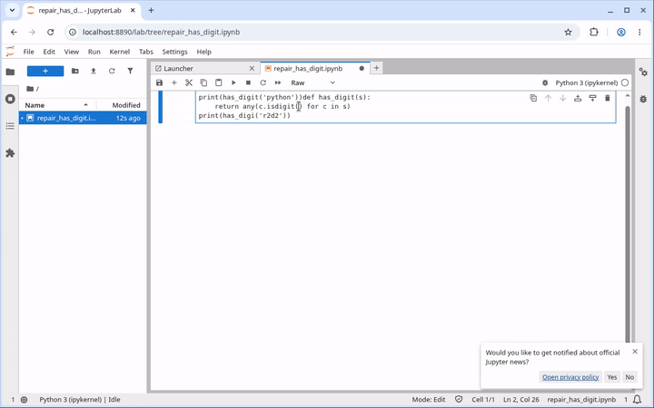
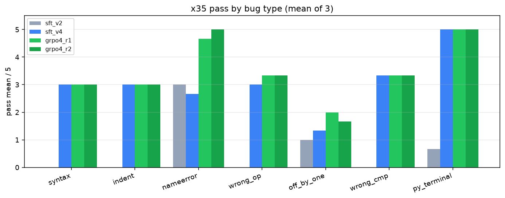
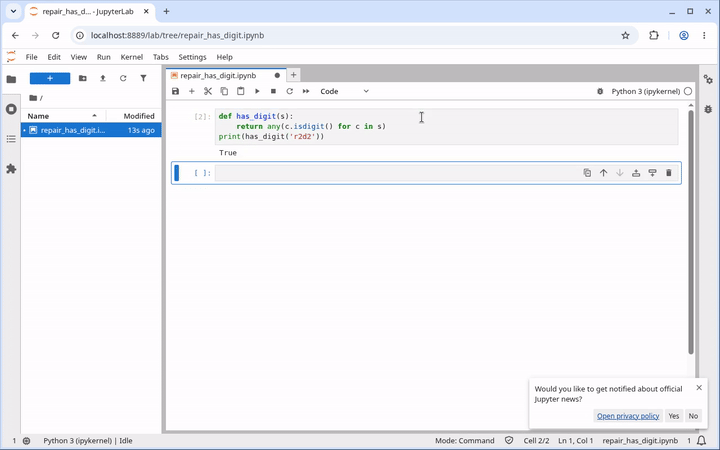
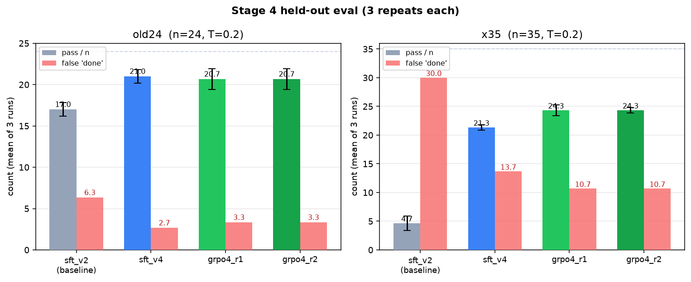

# I tried to teach a small model to use a computer

I wanted a model that could sit down at a computer and do what I do when something is broken.

Open Jupyter. Write a little code. Run it. Read the error. Fix the bug. Run it again.

The model I started with was [Qwen2.5-VL-7B](https://huggingface.co/Qwen/Qwen2.5-VL-7B-Instruct). It can see a screenshot and output actions: clicks, keystrokes, that kind of thing. In theory that is enough to use a computer. In practice, when I gave it a locked set of 24 tasks, it scored 0.

This is how I trained it, how I measured it, and what actually moved the score.

## What "using a computer" meant here

I did not want a chatbot that explains how to write a function. I wanted the model to operate the screen.

The loop was always the same:

1. Open Jupyter
2. Write the code
3. Run it
4. Read whatever came back
5. Fix the bug if there was one
6. Run it again

I used Jupyter because that is what I could actually run. The tasks were things like: write a new function, debug a file I gave it, deal with a screen layout that had changed, or fix a `.py` file from the terminal only.

## How I kept myself honest

The easy way to fool yourself with a project like this is to train on the same tasks you test on, or to trust the model when it says it is finished.

I locked two test sets before training and never used them as training data:

- **Original 24.** Write new functions, debug a provided file, handle a changed layout, or use the terminal only.
- **Debug 35.** Five each of seven bug types: syntax, indentation, name errors, wrong operator, off-by-one, wrong comparison, and a Python file fixed from the terminal.

An automatic checker looks at the files on disk. Does the function exist? Does the script print the right output? If the model says "done" and the file is still wrong, that is a fail. I called those false "done" claims, and there were a lot of them early on.

When I compared the trained models, I ran each test set 3 times at temperature 0.2 and averaged the scores. The untrained base score of 0/24 comes from an earlier single run on the same original 24 tasks.

You can check that the tests have not been edited:

```bash
cd tests/original-24 && sha256sum -c FROZEN.sha256
cd ../debug-35 && sha256sum -c FROZEN.sha256
```

## First I just showed it how

I sat down and did the tasks myself. I recorded the successful runs: open Jupyter, edit the code, run it, read the output, then stop. Then I fine-tuned the model on those demonstrations so it would copy the behavior.

That taught the basic loop. On the original 24 tasks, the first fine-tune averaged 17.0 out of 24, or 71%. After I added more careful debugging demonstrations, it averaged 21.0 out of 24, or 88%.

The debugging set was the rude surprise. After that first round of demos, it only got 4.7 out of 35, which is 13%. And it claimed to be done about 30 times per run, on a set of 35 tasks. It had picked up the habit of clicking around. It had not picked up the habit of actually fixing the bug.

## The model was sloppy in a very specific way

When I watched the failures, they were not mysterious.

It would edit the wrong line. It would rewrite a test. It would type a fix and never run the file. Or it would run the file, see an error, and say it was finished anyway.

Here is the last stretch of one of those failures, a NameError the early model did not actually fix:



So I recorded pickier demonstrations. The rule was simple: change only the buggy line, run the code, read the output, and only then say done.

That was the biggest jump in the whole project. Debugging went from 13% to 61% (21.3 / 35). False "done" claims dropped from 30.0 to 13.7.



Some bug types moved a lot once the demos were more careful. Others barely moved. That is how I knew that generic "just show it more computer use" was not going to be enough.

## Then I tried a little reinforcement learning

Imitation can only copy what you showed it. I still had cases the demos missed, so I ran a round of reinforcement learning (GRPO). The model got 8 attempts at a task. The ones that passed the checker were strengthened. The ones that failed, or that quit early, were pushed down. A small penalty kept it from drifting too far from the fine-tuned model.

One round took debugging from 61% to 70% (24.3 / 35). False "done" claims fell again, from 13.7 to 10.7. Most of that extra gain was on debugging, especially NameErrors.

Here is the same kind of NameError after that training:



A sped-up before-and-after of the full attempts is in [`examples/before-after.mp4`](examples/before-after.mp4).

It did not beat the demo-trained model on the original 24 tasks. After reinforcement learning it averaged 20.7 / 24 (86%), compared with 21.0 / 24 (88%) after the better demonstrations.

I ran a second round. It tied the first, on both test sets. So I stopped.



| Model | Original 24 | Debug 35 |
| --- | --- | --- |
| After early fine-tuning | 17.0 / 24 (71%) | 4.7 / 35 (13%) |
| After more targeted demos | **21.0 / 24 (88%)** | 21.3 / 35 (61%) |
| After one round of RL | 20.7 / 24 (86%) | **24.3 / 35 (70%)** |

## What this cost, and what I would still change

I do not have a GPU on the machine I was using, so I rented some for the last training stage. That stage cost about $12.

I would not spend more just to run another reinforcement learning round. The second round already told me I had plateaued. If I picked this up again, I would look at the bugs that are still hard, especially off-by-one errors, and record demonstrations that are picky about those, rather than hoping more generic training would smooth them out.

The model can use a computer now, in this narrow sense. It can open Jupyter, write code, run it, and often fix what it broke. It still says "done" sometimes when it is not, and it still misses tasks a person would catch.

The code, the locked tests, and the charts are in this repo: [computer-use-post-training](https://github.com/SarnadAbhilash/computer-use-post-training).
