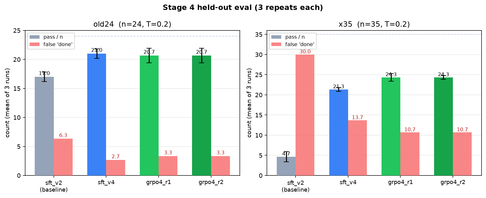
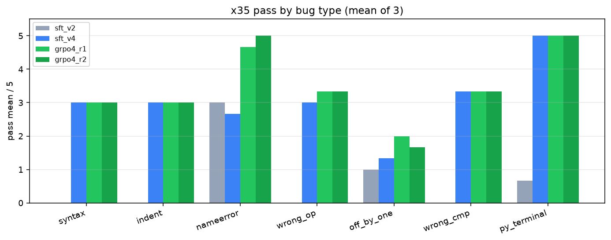

# Final results

Completed 2026-11-05. Eval protocol: two locked held-out sets (**original-24** and **debug-35**), 3 repeats each, temperature 0.2. Means ± population standard deviation over the 3 repeats. A false "done" claim means the model said `done` but the checker failed.

## Pass rates and false "done" (mean of 3)

| Suite | Model | Pass (mean ± sd) / n | False "done" (mean) | Breakdown (mean) |
| --- | --- | --- | --- | --- |
| original-24 | SFT v2 (earlier fine-tune) | **17.0 ± 0.8 / 24 (71%)** | 6.3 | T1 6.0, T2 2.0, T3 5.0, T4 4.0 |
| original-24 | SFT v4 | **21.0 ± 0.8 / 24 (88%)** | 2.7 | T1 7.3, T2 4.7, T3 5.0, T4 4.0 |
| original-24 | GRPO round 1 | **20.7 ± 1.2 / 24 (86%)** | 3.3 | T1 7.0, T2 5.0, T3 4.7, T4 4.0 |
| original-24 | GRPO round 2 | **20.7 ± 1.2 / 24 (86%)** | 3.3 | T1 7.0, T2 5.3, T3 4.3, T4 4.0 |
| debug-35 | SFT v2 (earlier fine-tune) | **4.7 ± 1.2 / 35 (13%)** | 30.0 | indent 0.0, nameerror 3.0, off_by_one 1.0, py_terminal 0.7, syntax 0.0, wrong_cmp 0.0, wrong_op 0.0 |
| debug-35 | SFT v4 | **21.3 ± 0.5 / 35 (61%)** | 13.7 | indent 3.0, nameerror 2.7, off_by_one 1.3, py_terminal 5.0, syntax 3.0, wrong_cmp 3.3, wrong_op 3.0 |
| debug-35 | GRPO round 1 | **24.3 ± 0.9 / 35 (70%)** | 10.7 | indent 3.0, nameerror 4.7, off_by_one 2.0, py_terminal 5.0, syntax 3.0, wrong_cmp 3.3, wrong_op 3.3 |
| debug-35 | GRPO round 2 | **24.3 ± 0.5 / 35 (70%)** | 10.7 | indent 3.0, nameerror 5.0, off_by_one 1.7, py_terminal 5.0, syntax 3.0, wrong_cmp 3.3, wrong_op 3.3 |

## Takeaways

- SFT v4 was the big lift versus SFT v2 (especially debug-35: 13% → 61%, false "done" 30 → 13.7).
- GRPO round 1 added another clear gain on debug-35 (61% → 70%) and cut false "done" claims (13.7 → 10.7). On original-24 it stayed about even with SFT v4 (88% → 86%).
- GRPO round 2 did not improve further (tied with round 1 on both suites). The best GRPO checkpoint is round 1.
- Training stopped after round 2. No third GRPO round.

The untrained base model scored **0 / 24** on the original set in an earlier single-run eval (separate from the 3-run protocol above).

The last training stage used about **$12** of GPU time.

## Charts

## Example videos

See `../examples/` for a before-and-after clip of one NameError task: SFT v2 fails it; GRPO round 1 succeeds.
